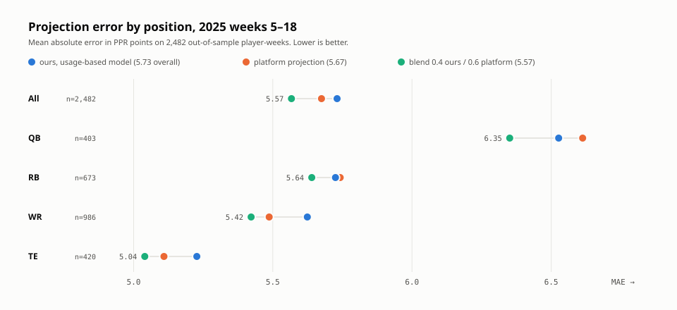

# fantasy-autopilot

Fantasy football for busy dads. Your agent sets the lineup, you watch the game.

A command-line tool that manages your own Sleeper and ESPN fantasy football teams
with your own credentials: rosters, matchups, waivers, lineups, IR, claims, and a
lineup optimizer that maximizes win probability instead of projected points.
Built to be driven by an AI agent, safe enough to let one drive it.

Not affiliated with Sleeper, ESPN or the NFL. Read the [honesty section](#what-you-should-know-before-using-it)
before you use it.

## What it does

- Reads everything the apps show you: state, roster, matchup, scoring, available
  players, waiver budget and order, pending claims.
- Writes the five things a manager actually does: set a lineup, place or activate
  IR, submit a claim, drop a player, cancel a claim. Trades are draft-only; nothing
  here can send one.
- `optimize.ts` picks the lineup with the best chance of beating this week's
  opponent, which is not the lineup with the most projected points.

## Safety model

Nothing is written without three things: the league is in a config file only you
hold, you passed `--confirm`, and the credential you supplied owns the team the
request names. Every write re-reads live state first and reads the platform back
afterwards, and reports `verified: true` or `false` rather than assuming.



The guard sits inside the one function each platform's writes go through, so a
caller cannot route around it. Tests exercise the real transport against a
scripted network: a request naming another league or team makes zero mutation
requests, every command without `--confirm` makes zero mutation requests, and a
readback that does not match reports `verified: false`.

Credentials are never printed, never written to disk, and never echoed in errors:
every failure from an authenticated host maps to a fixed category (`auth`,
`forbidden`, `not-found`, `rate-limited`, `server`, `transport`, `platform-rejected`)
plus a fixed explanation the code owns, because a platform error message can reflect
the request that carried your token.

## Quickstart

Requires [Bun](https://bun.sh).

```bash
git clone https://github.com/davekim917/fantasy-autopilot
cd fantasy-autopilot/skills/fantasy-football
cp ../../fantasy.config.example.json fantasy.config.json   # then edit it
bun fantasy.ts leagues
bun fantasy.ts auth-check all
```

### Config

```json
{ "leagues": [
  { "alias": "sleeper-league", "platform": "sleeper", "leagueId": "123456789012345678", "rosterId": 4 },
  { "alias": "espn-league", "platform": "espn", "leagueId": "12345678", "teamId": 2, "memberId": "{XXXXXXXX-XXXX-XXXX-XXXX-XXXXXXXXXXXX}" }
] }
```

Found by `--config PATH`, else `$FF_CONFIG`, else `./fantasy.config.json`, else
`~/.config/fantasy-football/config.json`. A named path that is missing fails closed
rather than falling through to another file. Sleeper league and roster ids are in
the league URL and the roster list; the ESPN league id is in the league URL, the
team id in your team page URL, and `memberId` is your SWID (below).

### Credentials

Set them in the environment or a local `.env` (gitignored; Bun loads it). They
grant full access to your account: treat them like a password, and do not paste
them into chat, shell history or a commit.

**Sleeper** (`SLEEPER_TOKEN`): sign in at sleeper.com, open the browser developer
tools, Network tab, open any league page and filter requests by `graphql`, select
one and copy the full value of its `Authorization` request header. No `Bearer`
prefix. Sleeper does not publish a token lifetime; when `auth-check` reports
`auth`, repeat this.

**ESPN** (`ESPN_S2`, `ESPN_SWID`): sign in at fantasy.espn.com, open developer tools,
Application (Chrome) or Storage (Firefox), Cookies, `fantasy.espn.com`, and copy
the values of `espn_s2` and `SWID` exactly as shown. `SWID` keeps its curly braces;
`espn_s2` is long and URL-encoded, and stays that way.

If neither is set, the tool sends no credential header at all. That is for people
who run an injecting proxy (the author's setup); see the caveat below.

## Commands

```
bun fantasy.ts [--config PATH] <command> <league> [flags]
```

| Command | What it does |
|---|---|
| `leagues` | the leagues in your config |
| `auth-check [league\|all]` | private reads for each league, and whether a write would be allowed |
| `state <league>` | season, current week, waiver and lock rules |
| `roster <league> [--week N]` | lineup, bench, IR with injury and lock status |
| `matchup <league> [--week N]` | your matchup and opponent |
| `scoring <league>` | scoring and roster settings |
| `players <league> [--pos RB] [--search name] [--limit N]` | available players |
| `waivers <league>` | budget, order, your pending claims |
| `set-lineup <league> --swap IN:OUT` | ESPN also `--move PLAYER:SLOT` |
| `ir <league> --place P \| --activate P` | IR moves |
| `claim <league> --add P [--drop P] [--bid N]` | waiver or free-agent claim |
| `drop <league> --player P` | release with no add |
| `cancel-claim <league> --id ID` | cancel a pending claim |
| `trade-draft <league> --with TEAM --give P1,P2 --get P3` | validates and summarizes; never sends |

Writes are a dry run unless `--confirm` is passed. `PLAYER` is a platform id or an
unambiguous name. Agent users: `skills/fantasy-football/SKILL.md` is the operating
doc an agent reads.

## Who to start

```bash
bun optimize.ts all            # or one alias, [--week N]
```

Sit/start is not "maximize projected points"; it is "maximize P(my total > their
total)". With about ten starters the sum is close to normal, so for a given
lineup `P(win) = Phi(z)` with `z = (mu - mu_opp) / sqrt(sd^2 + sd_opp^2)`, and one
rule falls out:

> a swap is right iff `d(mu) > z * d(sd)`

Favored (`z > 0`): variance costs you, play the floor. Underdog (`z < 0`): variance
pays, buy upside. Each player's `sd` is fitted, not assumed: the empirical spread
of (actual - projected) by position and projection size, in your league's own
scoring, from last season's completed weeks. Correlation between a QB and his pass
catchers, and between a D/ST and the offense it faces, is included. Changes inside
a 1.5 percentage-point dead band are reported as judgment calls, not math calls.

### The research behind it, and why the platform's projection stayed

`research/` holds a bottom-up projection engine (usage shares, team volume, Vegas
lines, Monte Carlo) and the backtest that measured it against the platform's own
projections on 2,482 player-weeks from 2025:



Standalone, it loses to the platform on accuracy. A 0.4/0.6 blend beats both.
The shipped optimizer therefore keeps the platform's mean and models the spread.
[research/README.md](research/README.md) tells the whole story, including the two
bugs found on the way; [research/process/](research/process/README.md) shows how
an agent ran a season with this tool and how its advice was verified before anyone
acted on it.

## What you should know before using it

**Unofficial endpoints.** Sleeper's official API is read-only. Writes here use the
web app's private GraphQL endpoint, and ESPN reads and writes use the private v3
API the ESPN web app uses, including a captured `platformVersion` value. Any of
these can change or disappear without notice; the readback catches a wrong result,
not a changed schema.

**Terms of service.** Sleeper's terms (updated 2026-10-06) let it restrict accounts
that use "unauthorized scripts or other automated means", and ESPN falls under
Disney's terms (2024-05-24), which prohibit automated access and sharing account
credentials. Accounts can be suspended. This tool acts only on your own team, at
your own instruction; whether to use it is your call.

**What has been sent live and what has not.** Sleeper lineup, IR and claim
writes and ESPN lineup and claim writes have been sent live and readback-verified
over a season. `drop` has never been sent on either platform (Sleeper's shape
matches several independent clients; ESPN's is inferred from the claim shape), and
`cancel-claim` has not been sent live either. Check `verified` on first use.

**ESPN in proxy mode.** With `ESPN_S2`/`ESPN_SWID` in the environment, the SWID is
the member and must equal the configured `memberId`. If a proxy injects the cookie
instead, the tool cannot see whose cookie it is: the config entry must carry
`"identity": "gateway-asserted"`, which is your statement that the proxy injects
that member's cookie. The tool still checks that the member owns the team; ESPN's
own authorization is the last line.

**No warranty.** It is a hobby project that has managed three teams for one season.
Read the tests before trusting it with yours.

## License

MIT. See [LICENSE](LICENSE).
